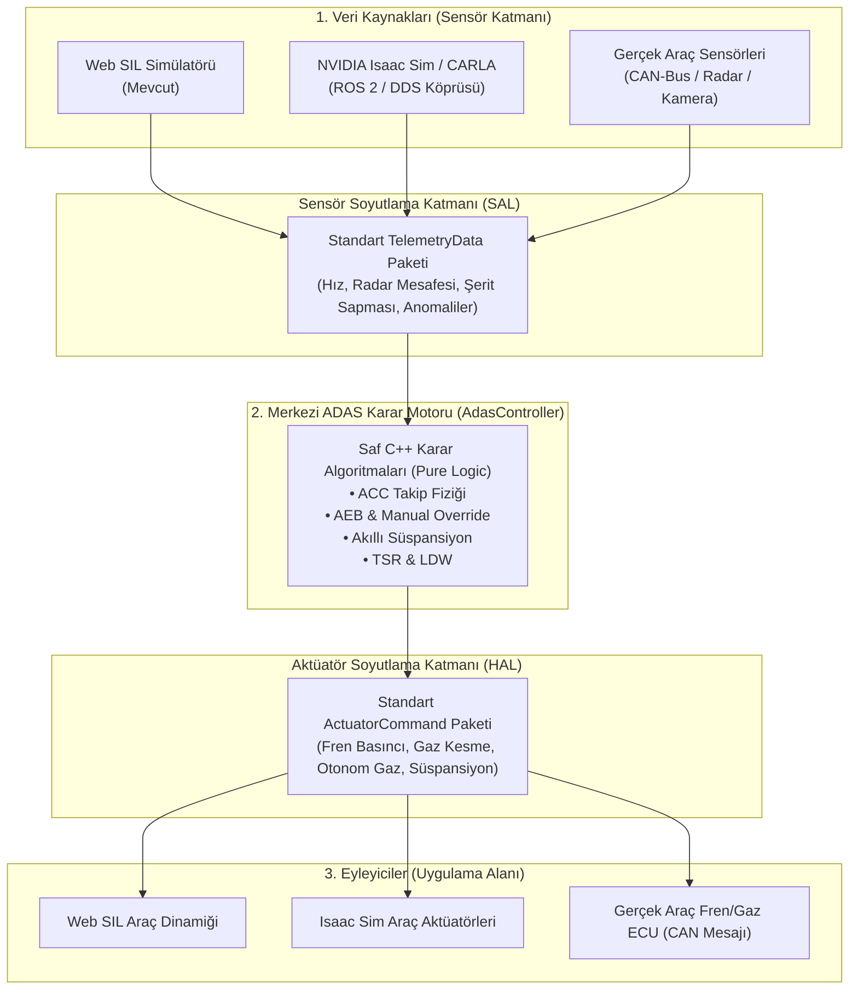

# 🚗 Otonom Araç ADAS Karar ve Kontrol Motoru (v2.0)

Modern otomotiv standartlarına ve **Software-in-the-Loop (SIL)** konseptine uygun olarak geliştirilmiş C++ tabanlı bir **ADAS (Gelişmiş Sürücü Destek Sistemleri)** karar motoru ve canlı web kokpit gösterge paneli altyapısıdır.

Proje; bağımsız karar çekirdeği, donanım/simülasyon soyutlama katmanı (HAL/SAL) ve canlı telemetri akışı sayesinde hem **Web Simülasyonu** üzerinde hem de gelecekteki **Robotik Simülasyon (NVIDIA Isaac Sim / CARLA / ROS 2)** ve **Gerçek Araç (CAN-Bus / ECU)** ortamlarında doğrudan çalışabilecek esnek bir mimariye sahiptir.

---

## 🌟 Öne Çıkan ADAS Yetenekleri

Sistem, aracın çevresel sensör verilerini gerçek zamanlı (20 Hz) işleyerek aşağıdaki 5 temel güvenlik ve konfor fonksiyonunu yerine getirir:

### 1. ⚡ ACC (Adaptif Hız Sabitleyici)
* **Hız Sabitleme Modu:** Ön yol boşken aracı sürücünün belirlediği hedef hıza (örn. 70 km/s) otonom olarak ivmelendirir ve sabit tutar.
* **Mesafe Takip Modu:** Radarda öndeki lider araç algılandığında dinamik güvenli takip mesafesini ($d_{\text{safe}} = 10\text{ m} + v \times 1.4\text{ s}$) hesaplar. Öndeki aracın hızına uyum sağlar, gerektiğinde yumuşak frenleme yapar.
* **Sürücü Önceliği:** Sürücü frene (`SPACE`) dokunduğu anda güvenlik gereği ACC otomatik olarak devreden çıkar.

### 2. 🛑 AEB (Otomatik Acil Frenleme) & Manual Override
* Öndeki araca kritik yaklaşma ($d \le 15\text{ m}$) veya çarpışma süresi riski ($\text{TTC} \le 1.5\text{ s}$) oluştuğunda %100 acil fren basıncı uygular.
* **Sürücüyü Ezme (Manual Override):** Acil fren anında sürücü gaza basmaya devam etse dahi gaz komutu baskılanır ve kaza önlenir.

### 3. 🛡️ Akıllı / Aktif Süspansiyon Yönetimi
* Yoldaki çukur ve tümsek gibi yol anomalilerini önceden radar/kamera ile tespit eder.
* Engele varış süresi 1.5 saniyenin altına indiğinde:
  - **Çukur:** Şasi konforu ve darbe emilimi için süspansiyon **%20 (Yumuşak)** moduna alınır.
  - **Tümsek:** Gövde salınımını önlemek için süspansiyon **%80 (Sert)** moduna alınır.
  - Engel geçildiğinde süspansiyon tekrar **%50 (Normal)** seviyesine döner.

### 4. 🪧 TSR (Trafik İşareti Tanıma & Hız Uyarısı)
* Yol kenarındaki hız tabelalarını (50, 70, 90 km/s) anlık okur.
* Araç hızı sınırı %10 aştığında kokpitte görsel ve sesli **Hız İhlali** uyarısı üretir ve aşım miktarını hesaplar.

### 5. 🛣️ LDW (Şerit Takip ve Bilinçli Sollama)
* Rüzgar veya yol eğimi sebebiyle şerit dışına kaymalarda (sapma > $\pm 0.5\text{ m}$) sürücüyü sesli/görsel olarak uyarır.
* **Bilinçli Sollama (State Machine):** Sürücü ilgili yöne sinyal verdiyse, bu manevra bilinçli kabul edilir ve şerit ihlal uyarısı otomatik olarak bastırılır.

---

## 🏛️ Geleceğe Uyumlu Sistem Mimarisi

Karar motorunun ortamdan bağımsız çalışabilmesi için **3 Katmanlı Mimari** uygulanmıştır:



* **Bağımsız Karar Motoru (`AdasController`):** Hiçbir somut donanıma veya simülatör sınıfına doğrudan bağlı değildir. Sadece `TelemetryData` okur ve `ActuatorCommand` üretir.
* **Soyutlama Arayüzleri (`VehicleInterfaces.hpp`):** `IVehiclePlatform`, `ISensorSource` ve `IActuatorSink` arayüzleri sayesinde tek satır karar kodu değiştirmeden farklı ortamlara (Web $\rightarrow$ Isaac Sim $\rightarrow$ Gerçek Araç) geçiş yapılabilir.

---

## 📁 Proje Dizin Yapısı

```text
ADAS-Kontrol-Motoru/
├── CMakeLists.txt                 <- Modern CMake derleme dosyası
├── README.md                      <- Proje dokümantasyonu ve mimari rehber
├── .gitignore                     <- Git yoksayma kuralları
├── docs/                          <- Ek dokümantasyon ve mimari raporlar
├── include/                       <- C++ Başlık Dosyaları (Header)
│   ├── VehicleInterfaces.hpp      <- HAL / SAL Soyutlama Arayüzleri
│   ├── AdasController.hpp         <- ADAS Karar Motoru Tanımı
│   ├── SensorSimulator.hpp        <- SIL Simülatör ve Araç Fiziği
│   ├── NetworkServer.hpp          <- Gömülü HTTP & REST API Sunucusu
│   ├── Logger.hpp                 <- Thread-safe Günlük Kayıt Sistemi
│   ├── httplib.h                  <- cpp-httplib HTTP Kütüphanesi
│   └── json.hpp                   <- nlohmann/json JSON Kütüphanesi
├── src/                           <- C++ Kaynak Dosyaları (Source)
│   ├── AdasController.cpp         <- ADAS Karar ve ACC/AEB Mantığı
│   ├── SensorSimulator.cpp        <- Fizik Motoru ve Sensör Üretimi
│   ├── NetworkServer.cpp          <- API Uç Noktaları ve JSON Köprüsü
│   ├── Logger.cpp                 <- Loglama İşleyicisi (system_log.txt)
│   └── main.cpp                   <- Simülasyon Ana Döngüsü (20 Hz)
└── web/                           <- Canlı Web Dashboard Arayüzü
    ├── index.html                 <- Gösterge Paneli ve Kontrol Masası
    ├── style.css                  <- Siber-Kokpit Arayüz Tasarımı
    └── app.js                     <- Canlı Telemetri ve Girdi Dinleyicisi
```

---

## 🛠️ Derleme ve Çalıştırma

### Gereksinimler
* C++17 destekli bir derleyici (MSVC 2019+, GCC 9+ veya Clang 10+)
* CMake (Sürüm 3.14 veya üzeri)

### Adım Adım Kurulum
```bash
# 1. Proje kök dizininde build klasörü oluşturun
mkdir build
cd build

# 2. CMake yapılandırmasını oluşturun
cmake ..

# 3. Projeyi Release modunda derleyin
cmake --build . --config Release

# 4. Uygulamayı başlatın
./Release/AdasDecisionEngine.exe   # Windows
```

Uygulama başladığında gömülü HTTP sunucusu **`http://localhost:8080`** portunda yayına başlar.

---

## 🎮 Canlı Web Kokpit Kullanımı

Sunucu çalışırken tarayıcınızdan **`http://localhost:8080`** adresine giderek kokpiti canlı kullanabilirsiniz.

### Klavye Kısayolları

| Tuş | Fonksiyon | Açıklama |
| :---: | :--- | :--- |
| **`W`** veya **`↑`** | Gaz Pedalı | Basılı tutulduğunda araç hızlanır. |
| **`SPACE`** | Fren Pedalı | Aracı yavaşlatır; basıldığında ACC devreden çıkar. |
| **`C`** | ACC Aç / Kapat | Adaptif Hız Sabitleyiciyi devreye alır veya kapatır. |
| **`+`** / **`-`** | ACC Hız Ayarı | ACC hedef hızını 5 km/s artırır veya azaltır. |
| **`A`** / **`Q`** | Sol Sinyal | Sol şerit ihlali uyarısını bilinçli sollamaya çevirir. |
| **`D`** / **`E`** | Sağ Sinyal | Sağ şerit ihlali uyarısını bilinçli sollamaya çevirir. |

### Ekrandaki İnteraktif Butonlar
* **Çukur / Tümsek Oluştur:** Test amaçlı yola anlık olarak 40 metre ileride engel yerleştirir.
* **Hız Sınırını Değiştir:** Hız tabelasını döngüsel olarak (50 $\rightarrow$ 70 $\rightarrow$ 90 km/s) değiştirir.
* **Sıfırla:** Simülasyonu ilk fabrika başlangıç değerlerine döndürür.

---

## 📝 Sistem Kayıtları (Logging)

Tüm sistem kararları, sensör olayları, AEB devreye giriş anları ve durum geçişleri:
1. Web arayüzündeki **Terminal Akışı** paneline canlı olarak yansıtılır.
2. Proje dizinindeki **`system_log.txt`** dosyasına zaman damgalı ve thread-safe biçimde kaydedilir.
